# Testmo Evidence Companion

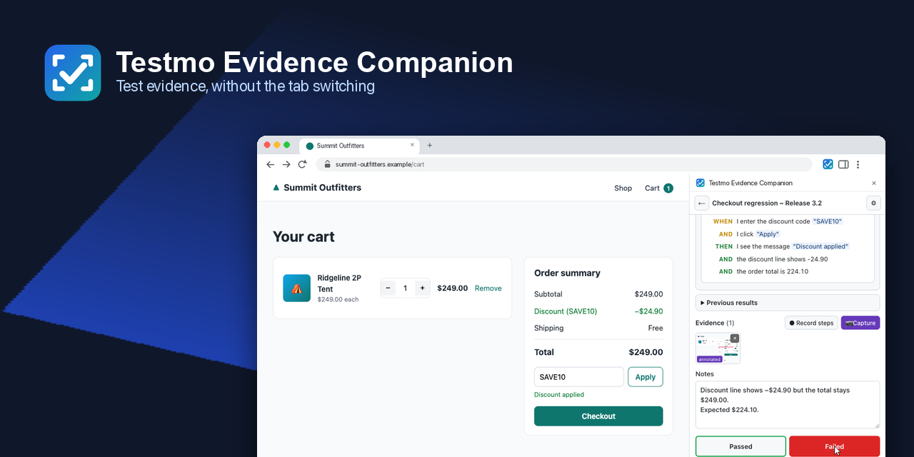

[](https://chromewebstore.google.com/detail/testmo-evidence-companion/jilejabcckkbglemalfdbdaamehjpljn)

A Chrome extension that lives in the browser **side panel** so testers can work through a
[Testmo](https://www.testmo.com) test run without leaving the page they are testing:

- pick a project and a run, see every test with its current status (Passed / Failed /
  Blocked / Skipped / Untested / any custom status your project defines);
- open a test and read its full instructions (steps, expected results, BDD scenarios,
  preconditions, any custom template field);
- capture a screenshot of the page under test with one click, annotate it (rectangle,
  ellipse, arrow, pen, highlighter, text, numbered markers, pixelate/redact, crop) and
  queue it as evidence;
- **record steps**: record the tab as video while every click, typed value, selection,
  key press, scroll and page change is logged as a numbered, timestamped
  "Steps to reproduce" list that is added to your notes;
- write notes, pick a status, submit — the result, notes and screenshots land in Testmo;
- notes, chosen status and screenshots are saved locally as drafts until you submit, so
  switching tabs, closing the panel or restarting Chrome does not lose work;
- **add a test case** from the bottom of the run's test list: write it in Gherkin with a live
  preview, and it is created in the right repository folder *and* added to the current
  run in one step.

The side panel is docked by Chrome next to the page: it pushes the page content aside
instead of covering it.

The extension contains **no organisation-specific data**: you enter your own Testmo
instance URL and your own API key. It is an independent open-source project and is not
affiliated with or endorsed by Testmo.

## See it in action

Capture the page, annotate the screenshot, write notes, submit — without leaving the tab:

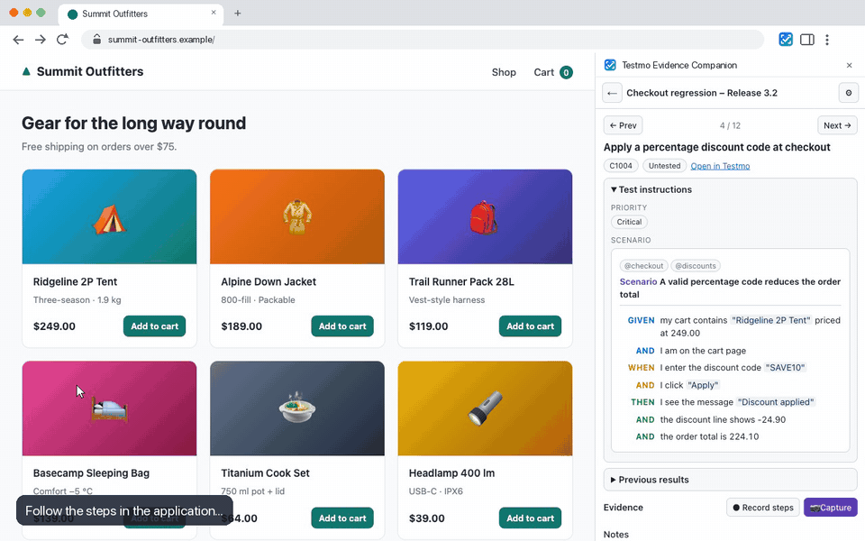

Record steps: the tab is recorded as video while every action becomes a numbered step:

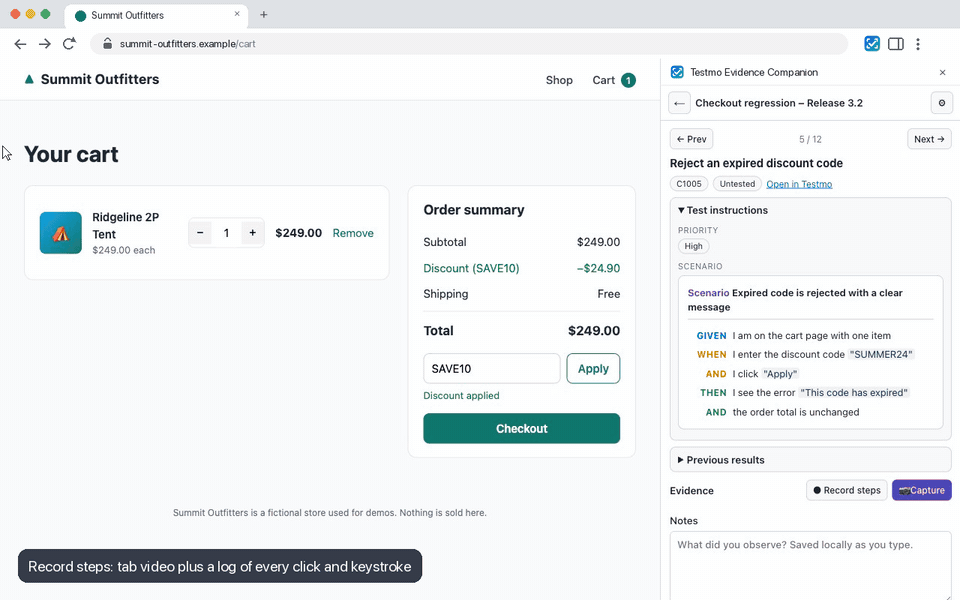

<details>
<summary>More clips and screenshots</summary>

Connect, browse runs, open a test:

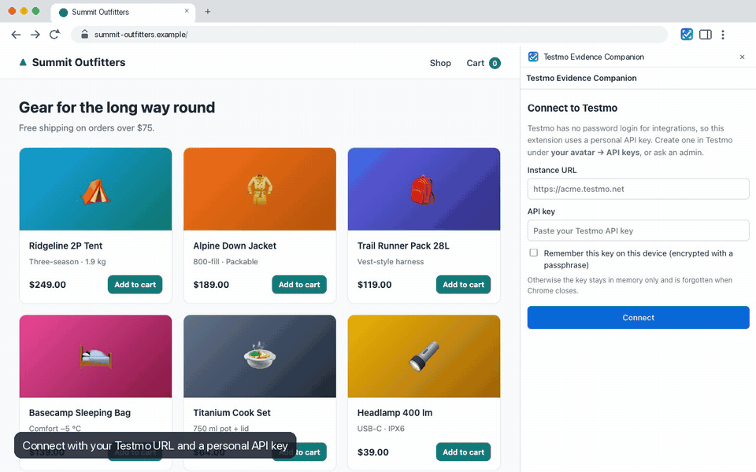

Add a Gherkin test case to the run from the panel:

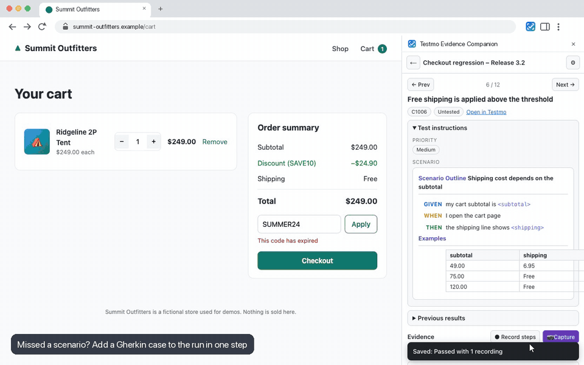

| | |
| --- | --- |
| 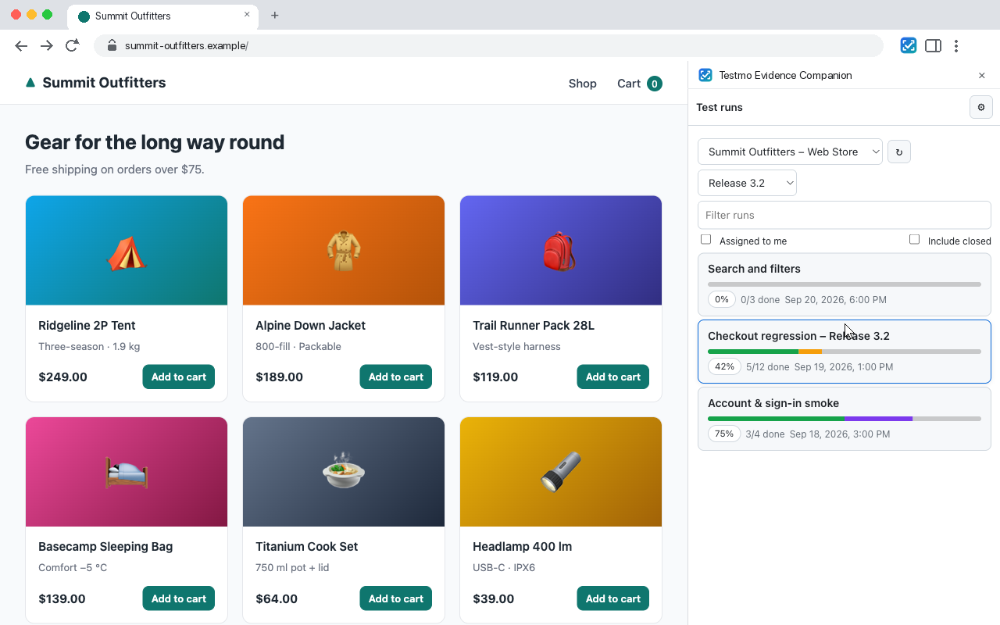 | 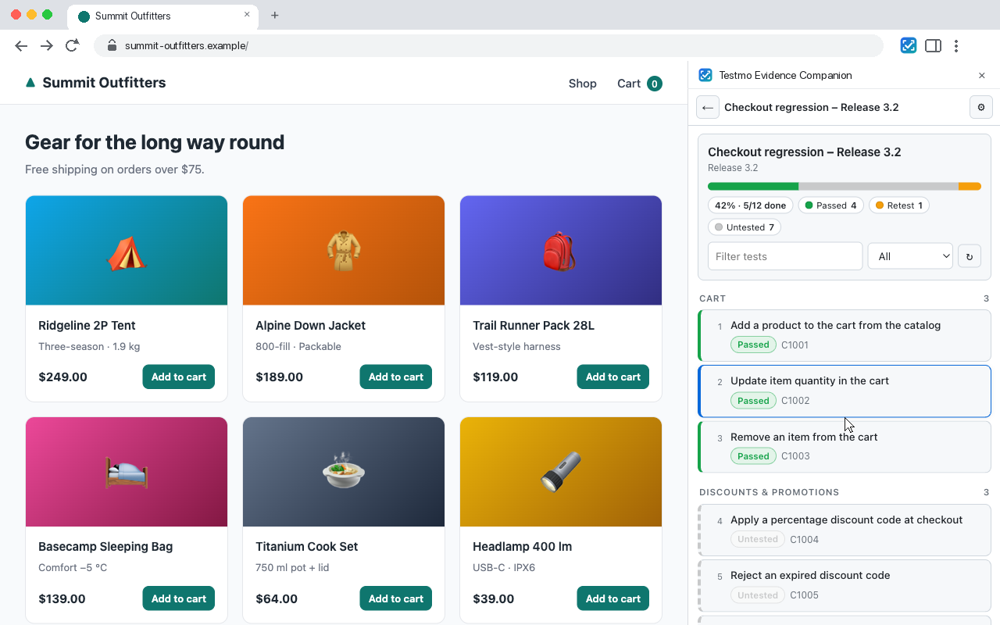 |
| 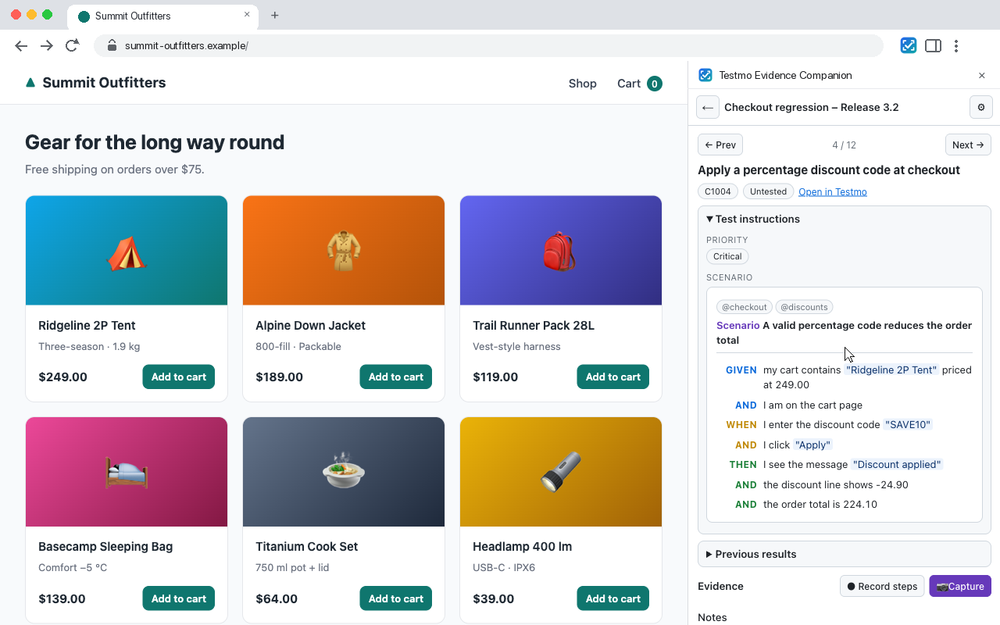 | 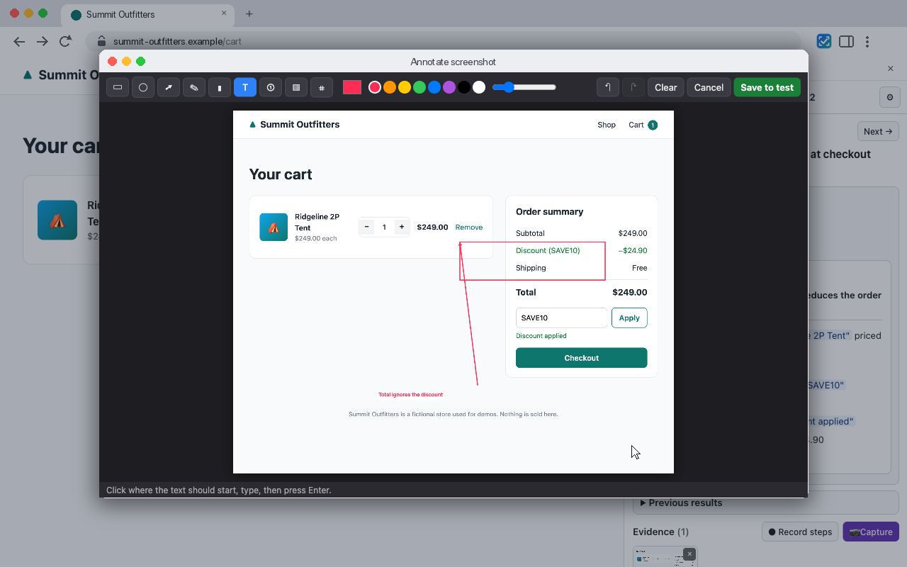 |
| 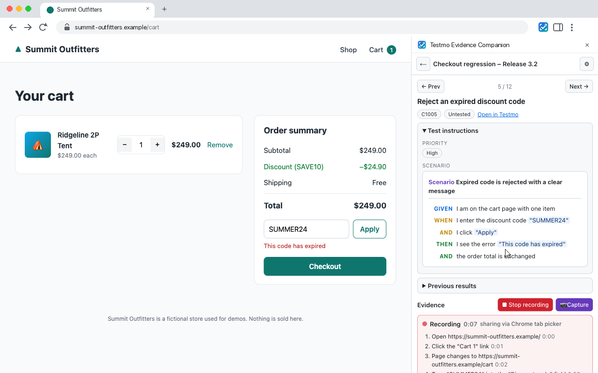 | 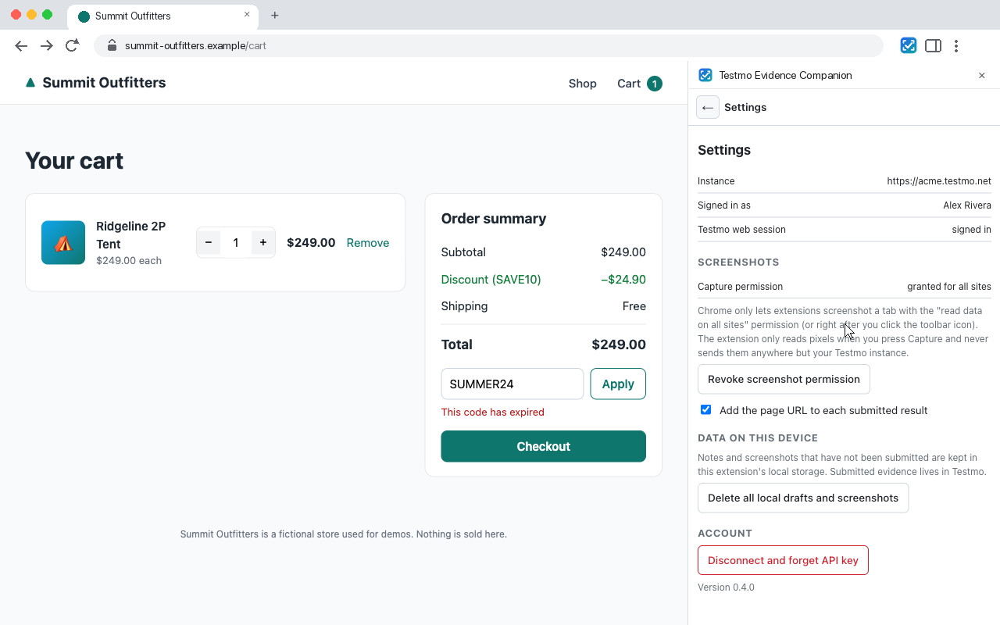 |

The full walkthrough is in [`docs/media/video/full-demo.mp4`](docs/media/video/full-demo.mp4).
Everything shown runs against the fictional data in [`demo/`](demo/README.md); no real
Testmo instance or company appears in any of it.

</details>

---

## Table of contents

1. [Requirements](#requirements)
2. [Install](#install)
3. [Connecting to Testmo](#connecting-to-testmo)
4. [Using the panel](#using-the-panel)
5. [How results and screenshots are stored in Testmo](#how-results-and-screenshots-are-stored-in-testmo)
6. [Permissions explained](#permissions-explained)
7. [Security](#security) — full analysis in [SECURITY.md](SECURITY.md)
8. [Sharing the extension](#sharing-the-extension) — full guide in [docs/DISTRIBUTION.md](docs/DISTRIBUTION.md)
9. [Development and tests](#development-and-tests)
10. [Architecture](#architecture)
11. [Known limitations](#known-limitations)
12. [Contributing and licence](#contributing-and-licence)

---

## Requirements

- Google Chrome 116 or newer (side panel API). Edge 116+ also works with the same
  manifest (Edge exposes `chrome.sidePanel`), but only Chrome has been tested.
- A Testmo account with permission to **view runs** and **add results** in the projects
  you test, plus a personal **API key** (see below).
- Optional but recommended: being signed in to your Testmo instance in the same Chrome
  profile. See [Why the extension also uses your Testmo browser session](#why-the-extension-also-uses-your-testmo-browser-session).

## Install

[Install from the Chrome Web Store](https://chromewebstore.google.com/detail/testmo-evidence-companion/jilejabcckkbglemalfdbdaamehjpljn). After installing, pin the extension (puzzle-piece icon in the toolbar, then the pin next to *Testmo Evidence Companion*) and click the icon to open the side panel.

To work on the code, or to try a local build, load it unpacked:

### Install for development (Load unpacked)

1. Clone or download this folder.
2. Open `chrome://extensions`.
3. Turn on **Developer mode** (top-right toggle).
4. Click **Load unpacked** and choose this folder (the one containing `manifest.json`).
5. Pin the extension: click the puzzle-piece icon in the toolbar, then the pin next to
   *Testmo Evidence Companion*.
6. Click the extension icon. The side panel opens on the right.

To update after pulling changes, click the reload icon on the extension's card in
`chrome://extensions`.

> Chrome shows a "Disable developer mode extensions" warning at start-up and, since
> Chrome 130, may disable unpacked extensions after a while. That is fine for trying
> the extension out; for a team, use one of the options in
> [docs/DISTRIBUTION.md](docs/DISTRIBUTION.md).

## Connecting to Testmo

Testmo has no username/password API for third-party tools; all integrations use a
personal **API key**, so that is what the extension asks for.

1. In Testmo, click your avatar (top right) → **API keys** (Testmo may label the
   section *Personal API keys*). If you do not see it, an administrator has to enable
   API access for your role.
2. **Add key**, give it a name such as `chrome-companion`, copy the key.
3. In the side panel enter your instance URL (for example `https://acme.testmo.net`)
   and paste the key.
4. Chrome asks you to allow the extension to access your Testmo host. This is
   required: it is how the panel talks to the Testmo API.
5. Choose how the key is kept:
   - **Default:** in memory only (`chrome.storage.session`). It is forgotten when Chrome
     quits and you paste it again next time.
   - **Remember this key on this device:** the key is encrypted with AES-256-GCM using a
     key derived from a passphrase you choose (PBKDF2, 310 000 iterations) and stored in
     `chrome.storage.local`. After a Chrome restart the panel asks for the passphrase.
     Without it the stored blob is useless.

Use **Settings → Disconnect and forget API key** to remove the key from this device.
Revoking the key in Testmo is always possible too and takes effect immediately.

### Why the extension also uses your Testmo browser session

Testmo's public REST API (v1) covers almost everything the panel needs, but it has two
gaps that matter for a "record evidence" tool:

1. It can list the **cases** in a run but not the **run-test ids** of tests that do not
   have a result yet, and a result can only be posted against a run-test id.
2. It can attach files to a **repository case**, but not to a **run result**.

To fill those gaps the panel makes a few calls to the same web routes the Testmo UI
uses, with the cookies of your normal Testmo login in this Chrome profile:

- `runs/view/{run}` or `todos` (GET) to detect the session and read the CSRF token,
- `runs/render_test_search/{run}` to look up the run-test id of a case,
- `attachments/create/{project}` and `runs/create_result/{test}` to save a result with
  real attachments,
- `todos/render_assignment_table` for the *Assigned to me* toggle.

If you are **not** signed in to Testmo in the browser:

- tests that already have a result work normally;
- untested tests show a *no test id* badge and a banner with a sign-in link; after you
  sign in and press refresh they become submittable;
- screenshots are uploaded to the **case** through the official API and embedded into
  the result note as images. It works, but the files pile up on the case over time,
  which is why the signed-in path is preferred.

Everything else — projects, runs, cases, statuses, results, history — always goes
through the official REST API with your API key.

**"Assigned to me"** has the same split. Testmo's API exposes an assignee only on
*results*, not on run tests that were merely assigned in the UI. So:

- signed in: the panel reads the assignment table of Testmo's *My work* page, which
  lists every run with tests assigned to you and how many;
- not signed in: it checks each listed run for latest results assigned to you, which
  misses tests that were assigned without a result. The note under the toggle tells you
  which source was used.

## Using the panel

| Screen | What you can do |
| --- | --- |
| **Runs** | Choose a project (remembered). Runs are filtered by **milestone**; the newest open milestone (your current sprint) is selected by default, and the choice is remembered per project. *All milestones* and *No milestone* are available too. Filter by name, **Assigned to me** toggle (off by default), *Include closed*. Each run shows a status bar, percentage and *done / total*. |
| **Run** | Tests grouped by repository folder, each with a status chip and a coloured edge (dashed for untested), *draft* and *camera* chips for unsubmitted work, filters (Untested / Done / Failed / With drafts), refresh from Testmo. |
| **Test** | Prev / Next, full instructions (Gherkin scenarios are rendered with highlighted keywords, quoted values, `<parameters>`, tables and tags), previous results with notes, **Record steps**, **Attach** and **Capture** buttons (or drop image files on the Evidence area), evidence tiles (screenshots open the annotator, recordings open a player with clickable steps; × deletes), notes, status buttons (first two are your project's primary statuses, the rest are secondary), elapsed timer, **Submit result**, *Next after submit* toggle. |
| **Add a test case** (button under the test list on the Run screen) | Name (defaults to the Scenario title), folder (preselected: the open test's folder, or the run's most common folder), template (BDD preselected). Template fields are rendered from your project's definitions: Gherkin editor with Given/When/Then buttons, Tab indentation and live preview for BDD descriptions; step/expected rows for step templates; dropdowns for priorities. **Create and add to run** creates the case in the repository, adds it to this run, and opens it so you can test it immediately. |
| **Recording** (inside the Test screen) | Live list of the actions detected so far with their time in the video. Stop with the same button, or by ending the share in Chrome's bar. |
| **Annotate** (popup window) | Tools: rectangle `R`, ellipse `E`, arrow `A`, pen `P`, highlighter `H`, text `T`, numbered marker `N`, pixelate `B`, crop `C`; colour swatches; stroke width; undo `⌘/Ctrl+Z`, redo `⌘/Ctrl+Shift+Z`; **Save to test** `⌘/Ctrl+S`. |
| **Settings** | Screenshot permission grant/revoke, whether the page URL is appended to results, delete local drafts, disconnect. |

Keyboard shortcuts on the Test screen (when not typing in a field):

- `→` / `J` next test, `←` / `K` previous test
- `S` capture screenshot
- First letter of a status selects it (e.g. `P` Passed, `F` Failed, `B` Blocked); press again to unselect
- `Enter` submits when a status is selected
- `Alt+Shift+S` captures from anywhere (Chrome-wide command, configurable in `chrome://extensions/shortcuts`)

### Add a test case to the run

Testmo normally makes this a round trip: repository → new case → back to the run → edit →
find the case → link. The *Add a test case to this run* button under the test list does it in one form. The case is created with
`POST /projects/{id}/cases` using the template you pick, then the run's case list is
updated with `PATCH /runs/{id}` (existing tests keep their ids and results). If you are
signed in to Testmo in the browser the new test is immediately submittable; otherwise it
shows the usual *no test id* badge until you sign in and refresh. Closed runs cannot take
new cases, so the button hides on them.

### Record steps

1. On a test, click **● Record steps**. Right after you opened the panel from the toolbar
   icon the tab is recorded directly; otherwise Chrome shows its "share this tab" dialog
   and you pick the tab under test.
2. Work through the scenario in the page. The panel lists what it sees, for example:

   ```
   1. Open https://app.example.com/settings (0:00)
   2. Type "Ada Lovelace" into the "Full name" field (0:04)
   3. Select "Norway" in "Country" (0:07)
   4. Check "I agree to the terms" (0:09)
   5. Enter a value into the "Password" field (hidden) (0:12)
   6. Click the "Save" button (0:15)
   7. Scroll to the bottom of the page (0:19)
   ```

   Labels come from the element's accessible name (label, aria-label, placeholder,
   button text…). Values typed into password fields or fields whose name suggests a
   secret are never recorded. Typing is logged once, when you leave the field.
3. Click **■ Stop recording**. The video is queued as evidence (`.webm`), and the step
   list is appended to your notes under *Steps to reproduce*, where you can edit it
   before submitting. Clicking a step in the recording preview jumps the video there.
4. Submit as usual. Signed in, the video is an attachment of the result; API-only, it is
   attached to the case and linked from the note.

While recording, a small script is injected into the tab to observe events. It is
removed when you stop, it only reports the events listed above, and it reads no page
content beyond the label and value of the element you interacted with. Switching to
another test stops the recording. Keep the panel open while recording: closing it ends
the recording.

## How results and screenshots are stored in Testmo

- One **result** is added to the run test with the status you picked, your notes
  (converted to simple paragraphs), the elapsed time from the panel's timer and, when
  enabled, the URL(s) of the page(s) you captured.
- Screenshots are named `C{caseId}-{yyyymmdd-hhmmss}-{n}.png`.
- Signed-in path: screenshots are **attachments on the result** (visible in the result's
  attachment strip in Testmo).
- API-only path: screenshots are **attachments on the repository case**, and the result
  note contains an `` link to each, so they still show inline under the result.
- Results are additive; Testmo keeps the history. Submitting again adds another result.

## Permissions explained

| Permission | Why |
| --- | --- |
| `sidePanel` | Show the UI in Chrome's side panel. |
| `storage` | Settings, drafts index, and the (encrypted) API key. |
| `unlimitedStorage` | Queued screenshots live in IndexedDB until submitted; PNGs are large. |
| `activeTab` | Lets **Capture** and **Record steps** work on the current tab right after you click the toolbar icon, without any host permission. |
| `tabCapture` | Records the tab's video for **Record steps** when the extension was invoked on that tab. Otherwise the standard tab-sharing dialog is used. |
| `scripting` | Injects the action recorder into the tab under test, only while a recording is running. |
| Optional host permission: **your Testmo host** | Requested when you connect. Needed to call the REST API and read your Testmo session for the two gap-fillers above. |
| Optional host permission: **`<all_urls>`** | Requested the first time a capture fails for lack of permission. Chrome's `captureVisibleTab` accepts *only* `activeTab` or the literal `<all_urls>` grant; per-site host permissions do not work for screenshots (verified against Chromium 141). Revoke it any time in Settings; the panel then falls back to the `activeTab` grant. |

The extension declares **no persistent content scripts**. The only code ever injected
into a page is the action recorder, injected while **Record steps** is running and
removed on stop. A screenshot is taken only when you press Capture (or the shortcut).

## Security

Short version — details, threat model and recommendations are in
[SECURITY.md](SECURITY.md):

- Your API key is as powerful as your Testmo account. Treat it like a password.
  Default storage is memory-only; the "remember" option is passphrase-encrypted.
- Anything with access to your Chrome profile on disk can read `chrome.storage.local`
  and IndexedDB. That includes unsubmitted screenshots, which may show sensitive data
  from the app under test. Use the pixelate tool before saving if needed, and delete
  drafts you no longer need.
- The extension talks to exactly one host: the Testmo instance you configured. There
  is no telemetry, no third-party script, no CDN.
- Rich text from Testmo (instructions, notes) is passed through an allow-list sanitizer
  before rendering.

## Sharing the extension

Options, from quickest to most controlled (full steps in
[docs/DISTRIBUTION.md](docs/DISTRIBUTION.md)):

1. **Zip + Load unpacked** — `npm run package` produces `dist/…zip`; colleagues unzip
   and load it. Good for a handful of people; Chrome nags about developer mode.
2. **Chrome Web Store, unlisted** — anyone with the link can install; no nagging,
   auto-updates. Requires a one-time $5 developer registration and a privacy policy
   (a template is in [docs/PRIVACY.md](docs/PRIVACY.md)).
3. **Chrome Web Store, private to your Google Workspace domain** — same, but only
   signed-in users of your organisation can see or install it.
4. **Managed Chrome policy** (`ExtensionInstallForcelist` / `ExtensionSettings`) — IT
   pushes it to every managed browser; works with an unlisted store listing or a
   self-hosted `.crx` + update manifest.

Publishing publicly later is fine: nothing in the code is specific to any organisation.

## Development and tests

```bash
npm test          # unit tests (node:test), no browser needed
npm run package   # dist/testmo-evidence-companion-<version>.zip
npm run demo:mock # a stand-in Testmo instance with fictional data (see demo/README.md)
```

You do not need a Testmo account to hack on the panel: `demo/` contains a mock Testmo
instance and a fictional web store, plus the scripts that recorded the media above.

End-to-end test (writes results to a real run — use a scratch run):

```bash
TESTMO_URL=https://acme.testmo.net \
TESTMO_API_KEY=… \
TESTMO_PROJECT_NAME="My project" \
TESTMO_RUN_NAME="scratch run" \
TESTMO_LOGIN_EMAIL=… TESTMO_LOGIN_PASSWORD=… \   # optional, exercises the signed-in path
PW_EXECUTABLE="/path/to/Chromium or Chrome for Testing" \
node test/e2e/run.mjs
```

The harness needs Playwright (`npm i -D playwright`, or point `PW_MODULE` at an existing
`playwright-core/index.mjs`) and a **Chromium / Chrome for Testing** binary: Google
Chrome 137+ ignores `--load-extension`. It launches a fresh profile, loads the
extension, connects, opens the run, captures and annotates a screenshot, submits a
Passed result through the signed-in path, verifies it through the REST API and in the
Testmo UI, clears cookies and submits a Failed result through the API-only path, then
checks the encrypted-vault unlock flow. Set `E2E_SCREENSHOTS_DIR` to save screenshots
of each screen.

## Architecture

```
manifest.json          MV3; side panel, service worker, optional host permissions
background.js          opens the panel on toolbar click; Alt+Shift+S capture command
sidepanel/             the panel UI (index.html, styles.css, app.js)
annotate/              screenshot annotator, opened in a popup window
lib/api.js             Testmo REST API v1 client (fetch + Bearer key)
lib/session.js         the three web-session calls that fill the API gaps
lib/runloader.js       loads case content for a run; resolves run-test ids
lib/runorder.js        orders the run list like Testmo: folder tree order, then case
lib/storage.js         settings, session key, passphrase-encrypted vault (WebCrypto)
lib/db.js              IndexedDB: drafts and screenshot queue, keyed by instance|run|case
lib/sanitize.js        allow-list HTML sanitizer for Testmo rich text
lib/capture.js         captureVisibleTab + permission helpers
lib/recording.js       tab video recording (tabCapture → getDisplayMedia fallback) + recorder injection
lib/steps.js           raw recorder events → readable "Steps to reproduce"
recorder/recorder.js   the action recorder injected into the page while recording
annotate/preview.*     recording player with clickable steps
test/unit, test/e2e    node:test unit tests; Playwright end-to-end harness
demo/                  mock Testmo instance, fictional store, demo recorder (not shipped)
docs/                  DISTRIBUTION.md, PRIVACY.md, STORE-LISTING.md, media/
icons/src/icon.svg     source of the toolbar icon
```

No build step, no dependencies at runtime: plain ES modules loaded by Chrome.

## Known limitations

- Fresh runs need a signed-in Testmo session (or one result recorded in Testmo) before
  the panel can submit — a limitation of Testmo's public API, explained above.
- The web-session calls target routes of Testmo's own UI (tested against Testmo
  1.14.x). If Testmo changes them, the panel falls back to the API-only behaviour and
  says so; nothing breaks silently.
- `captureVisibleTab` captures the visible viewport of the active tab only, and Chrome
  refuses to capture its own pages (`chrome://…`, the Web Store, other extensions).
- Loading a run's cases pages through the repository newest-first and pulls whole
  folders as it finds them. Runs that mix very old and very new cases in a huge
  repository can take a few seconds the first time; cases are cached per project
  afterwards.
- Results cannot be edited or deleted from the panel (by design: evidence is
  append-only). Use Testmo for corrections.

## Contributing and licence

Contributions are welcome; see [CONTRIBUTING.md](CONTRIBUTING.md) and the
[code of conduct](CODE_OF_CONDUCT.md). Chrome Web Store listing copy lives in
[docs/STORE-LISTING.md](docs/STORE-LISTING.md).

Released under the [MIT licence](LICENSE). Testmo is a trademark of its owner; this project
is not affiliated with or endorsed by Testmo.
